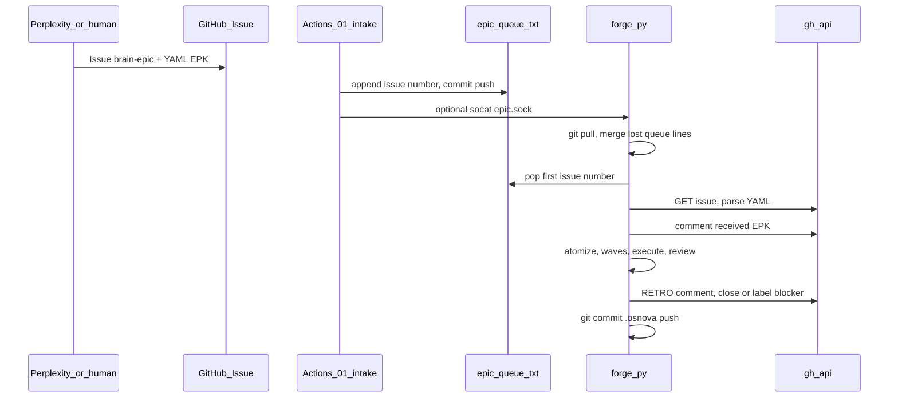

# Отчёт аудита: OSNOVA-FABRIKA vs blueprint Forge v5.0 / v5.1 / v5.2

**Дата:** 2026-03-28  
**Канон репозитория:** [`docs/osnova-forge-blueprint.md`](osnova-forge-blueprint.md), код [`forge/`](../forge/), [`.github/workflows/`](../.github/workflows/).  
**Внешние blueprint’ы:** v5.0 (email), v5.1 (GHA-native), v5.2 (resilient patch) — как чеклист возможностей.

---

## 1. Резюме

Реализация **v5.1+ и большей части v5.2** присутствует в коде: Issues + очередь, `epicwatcher`/`epic_watcher`, оркестратор [`forge/forge.py`](../forge/forge.py), `brain_fallback`, `degradation`, `parallel_executor` (волны), unix-socket wake, `heart`, workflow’ы **01** и **07**. Транспорт **email из v5.0 в коде не используется** (соответствует политике v5.1+).

Критические и высокие находки:

| Приоритет | Находка |
|-----------|---------|
| **P0 (операции)** | Workflow’ы [`01-epic-intake.yml`](../.github/workflows/01-epic-intake.yml) и [`07-heart-alert.yml`](../.github/workflows/07-heart-alert.yml) требуют runner с меткой **`osnova-forge`**. В [`docs/self-hosted-runner-runbook.md`](self-hosted-runner-runbook.md) задокументированы только метки **`osnova`**. Без отдельного runner’а с `osnova-forge` эти job’ы **не назначаются** и intake/heart-watchdog не выполняются. |
| **P1 (данные)** | [`forge/retrospective.py`](../forge/retrospective.py) читает CI-метрики из `proj_state.get("gha")`, тогда как фактический [`/.osnova/state.yaml`](../.osnova/state.yaml) использует блок **`ci`** (не `gha`). В результате **`ci_pass_rate` в RETRO-комментарии часто не подставляется**, пока ключи не согласованы. |
| **P2 (параллельность)** | [`forge/parallel_executor.py`](../forge/parallel_executor.py): `run_waves_sequential` исполняет атомы **последовательно** внутри волны (`Execute each wave: atoms run sequentially (single git worktree)`). Blueprint v5.2 описывает параллельный ThreadPool — **поведение намеренно упрощено**; ускорение только за счёт разбиения на волны, не за счёт параллельных процессов. |
| **P2 (GHA)** | Нет workflow **slash-команд** `/forge` (v5.1 §10.3). Управление паузой/инжектом через Issues **не реализовано** как в blueprint. |

---

## 2. Инвентаризация компонентов

### 2.1 Python-модули `forge/*.py`

| Файл | Назначение |
|------|------------|
| `forge.py` | Главный цикл: heartbeat, git pull, merge очереди, degradation, `_resolve_epic` (очередь → socket → fallback), `_process_epic` (atomize → waves → execute → review → finalize) |
| `common.py` | env, GH API, пути heartbeat/сокета/очереди, `forge-state.json` |
| `epicwatcher.py` | FIFO `epic-queue.txt`, `fetch_epic`, комментарий в Issue |
| `epic_watcher.py` | CLI для GHA: номер Issue |
| `epic_socket.py` | Unix socket listener для wake |
| `atomizer.py` | EPK → ATMs |
| `router.py` / выбор в `forge.py` | `choose_executor` + degradation |
| `degradation.py` | probe Qwen/Cursor, `resolve_executor` |
| `cursorexec.py` / `qwenexec.py` | Исполнители |
| `reviewer.py` | PASS/FAIL |
| `courier.py` | git commit/push, consecutive failures, blocker Issues |
| `retrospective.py` | history, state, meta RETRO, Issue comment, close/labels |
| `brain_fallback.py` | Локальный EPIC при простое > `BRAIN_IDLE_THRESHOLD` |
| `parallel_executor.py` | `build_waves`, `run_waves_sequential` |
| `heart.py` | Старая heartbeat, restart, бэкапы `forge-state.json` |
| `qwenbudget.py` | Бюджет Qwen |

**Отсутствуют как отдельные модули (v5.0 blueprint):** `postman.py`, `tracer.py`, `replay.py`, `curator.py` — см. §6.

### 2.2 GitHub Actions (релевантные forge)

| Workflow | Назначение |
|----------|------------|
| `01-epic-intake.yml` | Очередь + commit `forge/epic-queue.txt`, опционально `socat` → socket |
| `07-heart-alert.yml` | Внешний watchdog по возрасту heartbeat |
| `ci.yml` | Основной CI (reusable-node-run), self-hosted **`osnova`** на main |

Остальные workflow’ы (batch, regression, intelligence-schedule, …) — экосистема репозитория, не один-к-одному с номерами 02–06 из markdown v5.1.

---

## 3. Матрица соответствия capability → реализация

Легенда: **да** | **частично** | **нет** | **N/A (v5.0 / не целимся)**

| Capability (v5.1 / v5.2) | Статус | Где в репо |
|---------------------------|--------|------------|
| Шина EPIC через GitHub Issues + YAML | да | `epicwatcher`, `01-epic-intake` |
| Без email на основном контуре | да | Нет IMAP/SMTP в forge |
| Ретро в Issue + push `.osnova` | да | `retrospective.py` |
| GHA будит forge (очередь) | да | commit очереди + `git pull` в цикле |
| Unix socket wake | да | `epic_socket.py`, шаг в `01-epic-intake` |
| brain_fallback | да | `brain_fallback.py`, вызов из `forge.py` |
| degradation / executor probe | да | `degradation.py` |
| heart + backup state | да | `heart.py`, `osnova-heart.service` |
| 07 external heart watchdog | да | `07-heart-alert.yml` |
| Параллельные ATM в волне | частично | Волны есть; исполнение волны **последовательное** |
| state.yaml `gha` + обновление из CI | частично | В YAML — `ci`; ретро ищет `gha` — рассинхрон |
| 02 atm-verify как отдельный workflow | N/A по доке репо | Роль CI: `ci.yml` + др. |
| 03 slash `/forge` | нет | — |
| 04 watchdog schedule | частично | Нет отдельного `04-watchdog`; есть `07-heart`, intelligence/health по расписанию |
| 05 curator GHA | нет | Нет `curator.py` в forge |
| 06 cache-warm | частично | Кеш/зависимости в reusable CI, не отдельный `06-cache-warm` |
| v5.0 postman / SMTP RETRO | N/A | Не целевой контур |

### v5.0-only (legacy)

| Capability | Статус |
|------------|--------|
| Gmail `[BRAIN→FORGE]` / IMAP | **N/A** — не реализуется; документировано как историческое в [`osnova-forge-blueprint.md`](osnova-forge-blueprint.md) |

---

## 4. Контракты `.osnova/` (факт vs blueprint)

Blueprint v5.1 использует примеры с ключами в стиле `session_stats`, блок **`gha`**. В репозитории фактический [`/.osnova/state.yaml`](../.osnova/state.yaml) использует **плоские ключи без подчёркиваний**: `sessionstats`, `currentepic`, `brainsource`, `updatedat`, блок **`ci`** (не `gha`).

**Словарь (фрагмент, факт):**

| Поле (факт в репо) | Назначение |
|--------------------|------------|
| `v`, `session`, `updatedat` | Версия и время |
| `currentepic`, `epicprogress` | Текущий EPIC |
| `sessionstats` | Счётчики epics/atoms/passrate |
| `ci` | `lastrun`, `laststatus`, `passrate7d`, `lastepicissue` — аналог blueprint `gha` |
| `brainsource` | perplexity / fallback-local / idle |
| `heart`, `executors` | Мета v5.2 |
| `budget`, `zonemap`, `testcommands` | Расширения репозитория |

**Расхождение с кодом:** `retrospective.py` ожидает `gha.ci_pass_rate_7d`; нужно либо писать в `gha` при обновлении CI, либо читать `ci.passrate7d` в ретро — иначе таблица CI в комментарии пустая.

---

## 5. Паритет GHA «02–06» и slash-команды

Согласно [`osnova-forge-blueprint.md`](osnova-forge-blueprint.md), отдельные файлы `02`–`06` **намеренно не дублируются**; функции покрываются:

| Функция blueprint | Аналог в репозитории |
|-------------------|-------------------|
| 02 ATM verify + обновление state от CI | `ci.yml` → reusable script; **явного** шага «записать `ci`/`gha` в state.yaml» в просмотренном фрагменте **не видно** — стоит подтвердить при полном аудите job’ов |
| 03 команды человека | **Отсутствует** |
| 04 watchdog | Частично: `07-heart-alert`, прочие scheduled workflows |
| 05 curator | **Отсутствует** в forge |
| 06 cache-warm | Кеш в reusable workflow / npm ci |

**Slash-команды:** не найдены workflow на `issue_comment` с `/forge` — **gap относительно v5.1**.

---

## 6. Трейсы, replay, curator (v5.0 §11–12)

В каталоге `forge/` **нет** `tracer.py`, `replay.py`, `curator.py`.

**Альтернатива в монорепозитории:** пайплайн языка Основа пишет **`runs/traces.jsonl`** (см. [`docs/traces-v1.md`](traces-v1.md), `src/trace/traceStore.ts`), экспорт датасетов — `src/scripts/export-dataset.ts`. Это **отдельная система трейсов** (pipeline компилятора), не JSONL forge ATM/reviewer из blueprint v5.0.

**Вывод:** слой «SFT/DPO из forge-трейсов» из старого Living Forge **не перенесён**; данные для обучения идут из другого контура — осознанное архитектурное различие, не просто «забытый файл».

---

## 7. Прослеживание цикла Issue → forge → retro

Ниже — логика по коду, без запуска на живом GitHub.

**Замеченные разрывы / риски:**

1. **Метка runner `osnova-forge`** — без неё шаги intake/heart не бегут (см. §1).
2. **Очередь в репо:** при `git pull` чужой push может перезаписать `epic-queue.txt`; в `forge.py` есть **`_merge_epic_queue_after_git_pull`** для восстановления локально потерянных строк — корректная защита, но при конфликтах нужен дисциплина push очереди.
3. **fallback:** вызывается только если нет EPIC из очереди/socket и выполнены `is_brain_silent` и пустая очередь — соответствует v5.2 intent.

---

## 8. Операции: runner, systemd, секреты, SPOF

- **systemd:** в репозитории есть [`forge/osnova-forge.service`](../forge/osnova-forge.service) и [`forge/osnova-heart.service`](../forge/osnova-heart.service).
- **Секреты:** `GH_TOKEN` / `GITHUB_TOKEN`, пути в `forge/.env` / `OSNOVA_PROJECT` — см. [`forge/.env.example`](../forge/.env.example).
- **Runbook:** [`docs/self-hosted-runner-runbook.md`](self-hosted-runner-runbook.md) — хост VPS, два runner’а **`osnova`**, не `osnova-forge`.
- **SPOF:** один forge-процесс + один git worktree → последовательное исполнение ATM осознанно; отказ runner’а или токена блокирует intake/API; heart + 07 снижают «молчание» без алерта.

---

## 9. Внешний мозг (Perplexity 40 tasks)

Не входит в репозиторий. Для полноты эксплуатации проверить отдельно: Custom Instruction, **ШАГ 0** (антиспам Issues) из v5.2, расписание задач, владельца репо и прав на создание Issues.

---

## 10. Backlog (приоритизированный)

| ID | Приоритет | Действие |
|----|-----------|----------|
| B1 | P0 | Добавить runner с меткой **`osnova-forge`** на хост с forge **или** изменить `runs-on` в `01`/`07` на существующие метки и обновить документацию. |
| B2 | P1 | Согласовать **`gha` vs `ci`** в `retrospective.py` и писателях `state.yaml` (единый источник правды). |
| B3 | P2 | Решить: нужны ли **slash-команды**; если да — добавить workflow + обработчик. |
| B4 | P2 | Документировать: параллельность волны **отключена** из‑за одного worktree; либо будущий refork на изолированные worktrees. |
| B5 | P3 | Явно описать связь **forge** vs **`runs/traces.jsonl`** pipeline в одном doc (избежать путаницы с blueprint v5.0). |

---

## 11. Намеренные отличия от внешних документов

- **Email-транспорт** — не используется (v5.1+; v5.4 «не возвращается»).
- **Отдельные workflow 02–06** — заменены существующими CI/scheduled job’ами ([`osnova-forge-blueprint.md`](osnova-forge-blueprint.md)).
- **Tracer/replay/curator forge** — не реализованы; трейсы продукта — в `src/trace` и `runs/traces.jsonl`.

---

*Конец отчёта аудита.*
